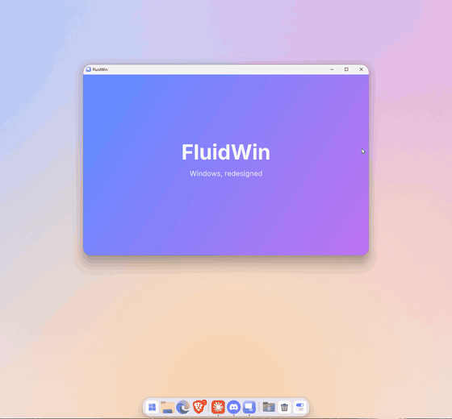
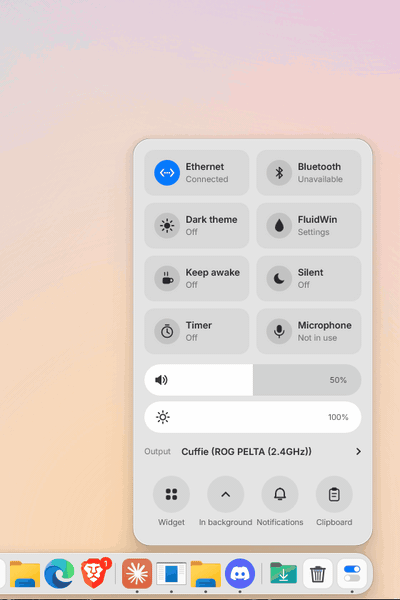
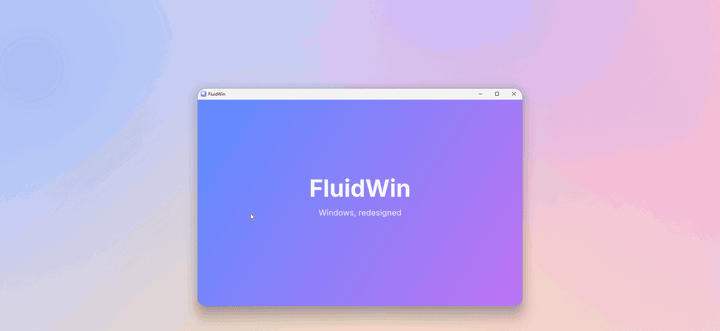
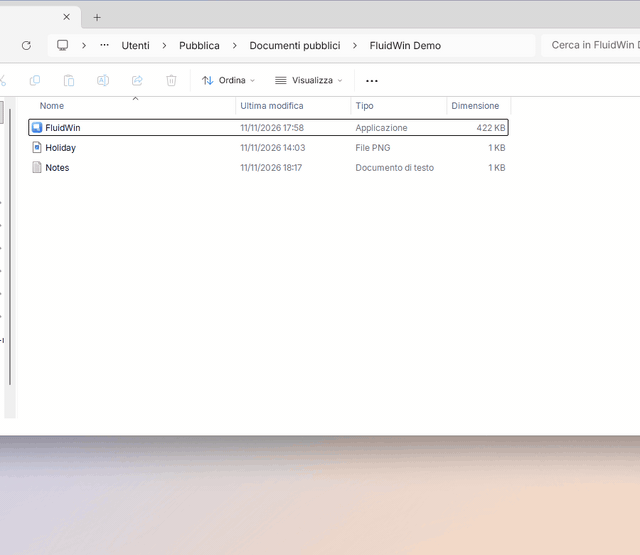
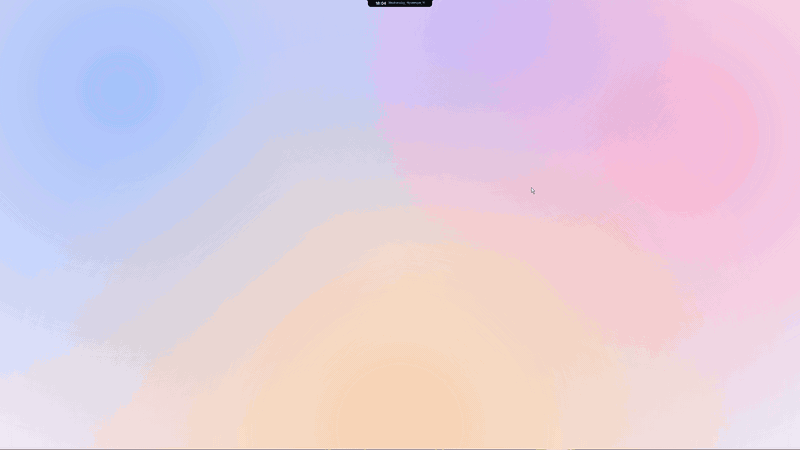

# FluidWin

**Windows, redesigned from scratch. By one person, for the love of it.**

FluidWin is my small personal project. One day I wondered what Windows would feel like if it were softer, more
alive and more pleasant to use. So I started redesigning it, one piece at a time.

It is an app that sits on top of Windows 11 and changes how it looks and feels. When you close it, Windows goes back
exactly to how it was.

  

## What it does

### The dock

The dock takes the place of the taskbar. It shows your apps, with a small number on the icon when an app has new
notifications. At the end you find a **Downloads** stack (click it to see your latest files) and the **Recycle Bin**,
where you can drag files to delete them.

If you use more than one screen, bring the mouse to the bottom edge of the other screen and the dock moves there.

### The notch

At the top of the screen there is a small notch that shows the time. When something happens, it grows and shows it:
the volume when you change it, notifications as they arrive, the song that is playing with its controls, and a timer.

<table>
  <tr>
    <td></td>
    <td></td>
  </tr>
  <tr>
    <td></td>
    <td></td>
  </tr>
</table>

It also has a **shelf**: drag files onto the notch to park them there, then drag them out wherever you need them.
A small dot lights up when an app is using the microphone or the camera, and a short notice appears when you connect
headphones or the battery is running low.

### The control center

The last icon of the dock opens the control center. Everything opens inside the same glass panel: Wi-Fi, Bluetooth,
dark theme, keep awake, silent mode (also for a set time), timer, microphone, notifications, calendar, weather and
news. On laptops it also shows the battery, with the time left.

  
  &nbsp;&nbsp;
  

From here you also open the **volume mixer**, with the volume of every audio output and, under it, a separate volume
for every app that is playing. Next to it there is the **clipboard history**, with the last things you copied.

### Windows that move

Windows **minimize into the dock** with a genie effect and come back out of it. They **open and close** with a
little bounce, and while you drag them they turn a bit "jelly-like", with their content still alive.

  

### The right-click menu

On the desktop and in File Explorer, the right-click menu puts everything in one place: no more "Show more options".
It has the same entries as the Windows menu, with small icons, a quick **Run as administrator**, and an arrow at the
bottom that shows the rest of the entries when you move the mouse over it.

  

### Search and overview

**Win+Tab** opens the search: apps, files, settings and quick math, while a wave of color lights up the edges of
the screen. **Alt+Tab** opens an overview of all your open windows, and you use it just like the Windows one: hold
Alt, press Tab to move, let go to switch.

  

### Custom cursors

Drop a cursor pack (a `.zip`, `.rar` or `.7z`, like the ones you find on DeviantArt) into the **Cursor** section of
the settings: FluidWin figures out which cursor goes where and uses it while it is open. When FluidWin closes, your
Windows cursors come back. It also works on Windows builds where the Windows settings don't apply custom cursors.

### Settings

Every feature can be turned on or off from the settings, divided into simple sections.

  

...and a lot more.

## What's new in 1.2.2

- **Maximize and restore animate the same way for every app**, with the maximize button, a double-click on the title
  bar or Win+Up/Win+Down, and without the flicker at the start (also with Windows Settings, File Explorer, Discord and
  apps that draw their own title bar buttons).
- **Custom cursors:** a new Cursor section in the settings (see above).
- **Battery** in the control center and in the notch notice, for laptops.
- The jelly effect starts reliably even right after another animation; clicks during an animation no longer reach the
  window behind.
- The clock in the dock adapts to the space; Store apps open faster from the dock.
- Fixed a rare crash at the end of an animation.
- Fixed the genie effect for apps whose minimize button is drawn by the app or answers like a title bar (Free
  Download Manager, Discord); "Close" in the dock closes like the Windows taskbar does.

## What's new in 1.2.1

A release focused on fixes and on the feedback received after 1.2.0.

- **Dock:** a dot for each open window (up to three) and the list of windows in the right-click menu; apps with
  untitled windows (and Discord, File Explorer, Teams, updated Store apps) are recognized as already open instead of
  starting again or showing two icons.
- **New Dock section in the settings:** auto-hide on or off, keep maximized windows above the dock, icon size, space
  between icons, opacity and color. The notch can be turned off, and the time and date can be shown in the dock.
- **Settings are easier to find:** right-click an empty spot of the dock (or the launcher or control center icon).
- **Alt+Tab:** the overview follows the Tab order, and the chosen window comes forward as soon as you release Alt.
- **The notch hides during full-screen videos** (and presentations), as it already did with games.
- **Start with Windows** option.
- **Lighter:** less memory and less work at start-up (the app list and its icons load only when you open the
  launcher), and the notifications panel opens at once.
- **Right-click menu:** a new right-click replaces the open menu; faster in folders with many files; scrolls when it
  is too long.
- **Safer restore:** if FluidWin is closed from Task Manager (even with "End process tree"), the Windows taskbar and
  your windows go back to normal. An app that stops responding no longer freezes FluidWin, and many rare cases where a
  window could stay transparent or "always on top" are fixed.
- Many smaller fixes found by an independent code review.

## What's new in 1.2.0

- The notch comes alive: volume, notifications, music, timer, shelf, microphone and camera dots.
- Volume mixer and clipboard history in the control center.
- Keep awake, silent mode for a set time, and a microphone switch.
- Notification badges, Downloads stack and Recycle Bin in the dock.
- A new right-click menu for the desktop and File Explorer.
- **Ctrl+Win+T** keeps any window always on top.
- Uninstall apps directly from the launcher.
- A clearer settings window, with a diagnostics report for bug reports.
- Better support for more than one screen and for screens with different scaling.
- **Alt+Tab** now opens the overview and **Win+Tab** the search (before it was the other way around).

## Keyboard shortcuts

| Keys         | What it does                                  |
|--------------|-----------------------------------------------|
| Alt+Tab      | Overview of your open windows                 |
| Win+Tab      | Search                                        |
| Ctrl+Win+T   | Keep the active window always on top (or not) |

## How to try it

1. Go to the **[latest release](../../releases/latest)** and download the `FluidWin-x.y.z.zip` file (under
   **Assets**).
2. Extract it anywhere and open `FluidWin.exe`.

That's it. There is nothing to install and nothing else to download.

> Windows may say "Windows protected your PC": this happens with new apps that have no digital signature. Click
> **More info**, then **Run anyway**.

You need **Windows 11**.

## How to close it

Open the **control center** (the last icon on the right of the dock), then **In background**, **FluidWin**, **Exit**.
From the same menu you can open the **settings** and turn each feature on or off. You can also open them by
right-clicking an empty spot of the dock.

To remove it completely, close it and delete its folder.

## How FluidWin is made

FluidWin is an AI-assisted project, built with Claude Code.

I don't write every line of code myself. My role is to define the vision, design the experience, make architectural
decisions, set development constraints, review the implementation, test the results and guide every iteration until
the software behaves as intended.

AI is the implementation tool, not the project owner.

One of my main design principles is to keep FluidWin as non-invasive as possible: it works on top of Windows rather
than attempting to replace or deeply modify the operating system.

I believe AI-assisted development can produce meaningful software when paired with clear direction, careful
supervision, testing and personal responsibility.

The source code is public, so anyone can inspect how FluidWin works and judge the result for themselves.

## Good to know

- This is still an **early version**. I tested it carefully on my PC, but not on every PC in the world. If something
  doesn't work, tell me in the [Issues](../../issues). In the settings, **General**, **Diagnostics**, **Copy** gives
  you a short report (with no personal data) to paste there.
- The interface is in **English** and **Italian** (you can switch in the settings).
- It doesn't ask for administrator rights, doesn't touch Windows files and doesn't inject code into other apps.
- It only goes online for the weather ([Open-Meteo](https://open-meteo.com)) and the news
  ([ANSA](https://www.ansa.it)).

## For those who want to look at the code

It's all here, in C++. To build it you need [MSYS2](https://www.msys2.org) with `mingw-w64-ucrt-x86_64-gcc`, then
run `compila.ps1`.

## License

[MIT](LICENSE): you can use it, change it and share it freely. (c) 2026 Clooudy.

FluidWin is an independent project, not affiliated with Microsoft.
